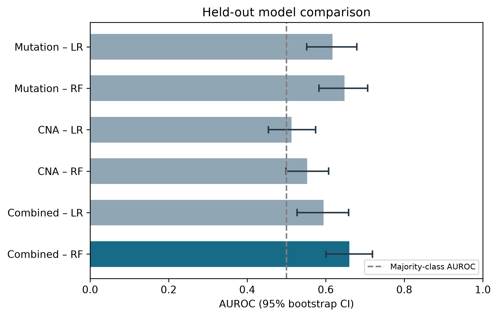
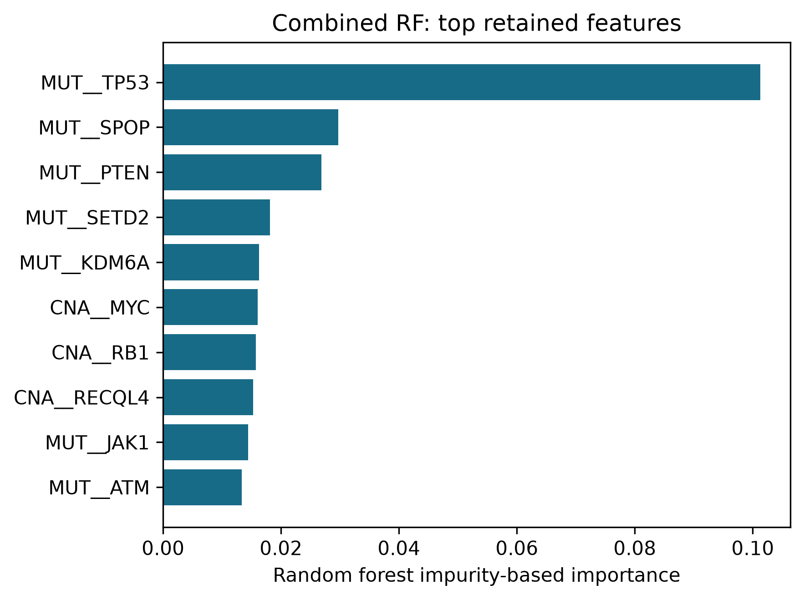

# Prostate Cancer Stage Classification from Somatic Mutations and Copy-Number Alterations

**EXSU 500 · Fundamentals of Artificial Intelligence in Medicine · McGill University · Fall 2026**

> **Research and educational prototype only.** This work is not a medical device, has not undergone external clinical validation, and must not be used for diagnosis, treatment, or clinical decision-making.

## Overview

Can somatic mutations and copy-number alterations (CNAs), alone or combined, distinguish highest recorded Stage IV prostate cancer from Stages I-III? This project compares two classical supervised-learning methods-regularized logistic regression (LR) and random forest (RF) across three genomic feature representations, for six model configurations.

The label, `STAGE_HIGHEST_RECORDED`, is the highest stage in the registry and may not be the stage when the sequenced specimen was collected. This is a **retrospective classification exercise**, not prospective prediction of metastasis or clinical outcomes.

## Dataset

The project uses the open Prostate Cancer (MSK, Clinical Cancer Research 2024) cohort from [cBioPortal](https://www.cbioportal.org/study/summary?id=prostate_msk_2024) (study ID `prostate_msk_2024`). Raw patient-level data and derived matrices are deliberately excluded from this public repository.

| Cohort / representation | Count |
|:--|--:|
| Source clinical patients / samples | 2,257 / 2,260 |
| Eligible patients, one specimen per patient | 1,967 |
| Stages I–III (`0`) | 943 (47.9%) |
| Stage IV (`1`) | 1,024 (52.1%) |
| Reported mutation records | 9,651 |
| Mutation records inconsistent with panel gene lists, excluded | 211 (2.2%) |
| Genes shared across all four sequencing panels | 341 |
| Shared-panel CNA features | 340 |
| Combined features | 681 |

Patient-level stratified splitting uses a fixed seed (`42`) with 1,376 train, 295 validation, and 296 test patients. All six configurations use the same split. After choosing hyperparameters using validation performance, finalized models are refitted on train + validation (1,671 patients); the held-out 296 patients are evaluated once.

## Methods

| Input | Representation | Models |
|:--|:--|:--|
| Mutations | 341 binary gene-level mutation indicators | LR, RF |
| CNA | 340 discrete copy-number calls | LR, RF |
| Combined | Concatenation of 341 mutation and 340 CNA indicators/calls | LR, RF |

To minimize unequal assay coverage, features are restricted to the intersection of genes sequenced by IMPACT341, IMPACT410, IMPACT468 and IMPACT505. Mutation records not matching their recorded panel definitions are excluded from the corresponding features; no patients are removed for this reason. For a covered gene, an unreported mutation is encoded as `0`; a recorded mutation is `1`. Original CNA values are retained, including the unusual `-1.5` category. Train-constant features are removed using `VarianceThreshold`; LR additionally uses `StandardScaler`. Both transformations are fitted on training data inside scikit-learn pipelines.

LR tuning considers `C ∈ {0.01, 0.1, 1, 10}`; RF tuning compares maximum depth and leaf-size choices. Validation AUROC is used for selection, with average precision (AP) as a secondary metric. The majority-class classifier serves as a trivial reference. Final test analysis also includes AUROC confidence intervals (1,000 patient-level bootstrap resamples), accuracy, sensitivity, specificity, F1, confusion matrices, ROC/PR curves, calibration, exploratory subgroup performance and paired comparisons.

## Held-out results

These are test-set results, reproduced from the exported `04_model_evaluation.ipynb` evaluation tables, not from the synthetic model-training dry run.

| Feature set | Model | Test AUROC | Average precision (AP) |
|:--|:--|--:|--:|
| Combined | **Random forest** | **0.660** | **0.664** |
| Mutation | Random forest | 0.648 | 0.659 |
| Mutation | Logistic regression | 0.617 | 0.644 |
| Combined | Logistic regression | 0.594 | 0.633 |
| CNA | Random forest | 0.552 | 0.586 |
| CNA | Logistic regression | 0.513 | 0.534 |
| Majority class (all Stage IV) | Baseline | 0.500 | 0.520 |

The validation-selected Combined RF achieved an AUROC of 0.660 (95% bootstrap CI 0.600–0.719), accuracy 63.5%, sensitivity 70.1%, specificity 56.3%, and AP 0.664. The majority-class baseline accuracy was 52.0%.



Combining mutations with CNAs improved AUROC relative to CNA-only RF (difference +0.108), but the improvement relative to mutation-only RF (+0.012, bootstrap CI includes zero) was inconclusive. These are exploratory paired comparisons, not multiplicity-adjusted hypothesis tests. The model shows modest discrimination, rather than clinical-grade performance.



## Reproduce the workflow

Professor/TA quick start: See [How to reproduce and grade the project](docs/INSTRUCTIONS.md) for exact commands, expected cohort sizes, expected saved files, and reference results. 

Prerequisites: Python 3.12, Git and Jupyter. Run commands from the repository root.

```powershell
conda create -n exsu500 python=3.12 -y
conda activate exsu500
python -m pip install -r requirements.txt
```

1. Obtain the official study archive `prostate_msk_2024.tar.gz` from cBioPortal and place it at `data/raw/prostate_msk_2024.tar.gz`. Use the actual cBioPortal archive, **not Git LFS pointer files**.
2. Download the cBioPortal JSON definitions for `IMPACT341`, `IMPACT410`, `IMPACT468`, and `IMPACT505` into `data/raw/panels/<PANEL_ID>.json`; see [data instructions](data/README.md).
3. Generate the processed files and run structural QC:

```powershell
python scripts/prepare_msk_data.py --archive data/raw/prostate_msk_2024.tar.gz --output-dir data/processed
python scripts/build_msk_masters.py --input-dir data/processed
python scripts/validate_msk_data.py --input-dir data/processed
```

4. Open Jupyter from the repository root (`python -m jupyter lab`) and run the four notebooks in numerical order (see below). Paths resolve from either the repository root or `notebooks/`.

| Notebook | Purpose |
|:--|:--|
| [`01_data_check.ipynb`](notebooks/01_data_check.ipynb) | Check the loaded source tables, patient IDs and labels |
| [`02_split_preprocessing.ipynb`](notebooks/02_split_preprocessing.ipynb) | Reproduce patient split and build mutation/CNA/combined matrices |
| [`03_model_training.ipynb`](notebooks/03_model_training.ipynb) | Compare baselines, tune on validation and refit final models |
| [`04_model_evaluation.ipynb`](notebooks/04_model_evaluation.ipynb) | Evaluate frozen models on held-out test data and export figures/tables |

The trained `.joblib` files and all patient-level prediction tables are written under `data/processed/` and are intentionally ignored by Git. Outputs for publication-style figures are under `data/processed/evaluation/`; selected aggregate figures are reproduced here. Do not upload individual patient predictions or raw data to public GitHub.

See [Reproducibility notes](docs/INSTRUCTIONS.md) for generated files, assumptions, and expected checks. Data-lead QC and field definitions are available in [`docs/`](docs/).

## Limitations and responsible use

- `STAGE_HIGHEST_RECORDED` is not necessarily stage at biopsy. In the selected data, 349 Stage I–III-labelled patients have specimens designated `Metastasis`, indicating annotation/timing ambiguity.
- The cohort is from one data source and has not been externally validated. Genomic feature sparsity and panel/batch effects may limit generalization.
- Excluding 211 unmatched mutation records avoids unsupported gene-coverage assumptions, but some discrepancies may reflect gene-symbol aliases rather than erroneous calls.
- An unusual source CNA value (`-1.5`) is preserved; its precise biological meaning requires verification.
- RF impurity-based feature importance is global and does not establish causal effects or explain an individual's prediction. Predicted probabilities are not clinically calibrated confidence estimates.

## Team and contributions

| Team member | Role |
|:--|:--|
| Huibin Benny Ji (`Crat400`) | Model lead: feature engineering, training and evaluation coordination |
| Mehdi Haghi (`mehdihaghi11-dev`) | Data lead: preprocessing and QC |
| Sachsin Sinnathurai (`SachsinSinnathurai`) | Writing lead: literature synthesis and report drafting |
| Parvinder Ahlawat (`ParvinderAhlawat92`) | Interface lead: prototype and visualization coordination |

Contributions reflect accountable team roles, not a certified record of every completed task. See the proposed full CRediT mapping in [CONTRIBUTIONS.md](CONTRIBUTIONS.md), to be confirmed by all authors before submission.

## Generative AI disclosure

OpenAI ChatGPT (GPT-6) assisted with data evaluation, code development and troubleshooting, and report editing. The team remains responsible for verifying methods, citations, code and reported results. The expanded disclosure is in [GENERATIVE_AI.md](GENERATIVE_AI.md).

## Citation and license

Please cite the primary MSK 2024 dataset publication and cBioPortal when reusing this work. Relevant methodological studies include Elmarakeby *et al.* (Nature, 2021), Lenis *et al.* (Clinical Cancer Research, 2024), and Kapoor and Narayanan (Patterns, 2023). See the course report for the full bibliography.

The project code is provided under the [MIT License](LICENSE). The source dataset is not redistributed; its original attribution and use conditions still apply.


## Interactive Web Application

The trained Combined Random Forest model is available through a
publicly accessible Streamlit interface.

**Live application:** [Prostate Cancer Genomic Classifier](https://prostate-genomic-classifier-exsu500.streamlit.app/)

The interface supports:
- Interactive synthetic genomic examples
- CSV upload with input validation
- Stage classification and predicted probabilities
- Genomic feature importance visualization
- Model performance metrics and limitations

**Disclaimer:** This application is a course prototype for research
and educational purposes only. It is not a medical device and must
not be used for clinical decisions.
